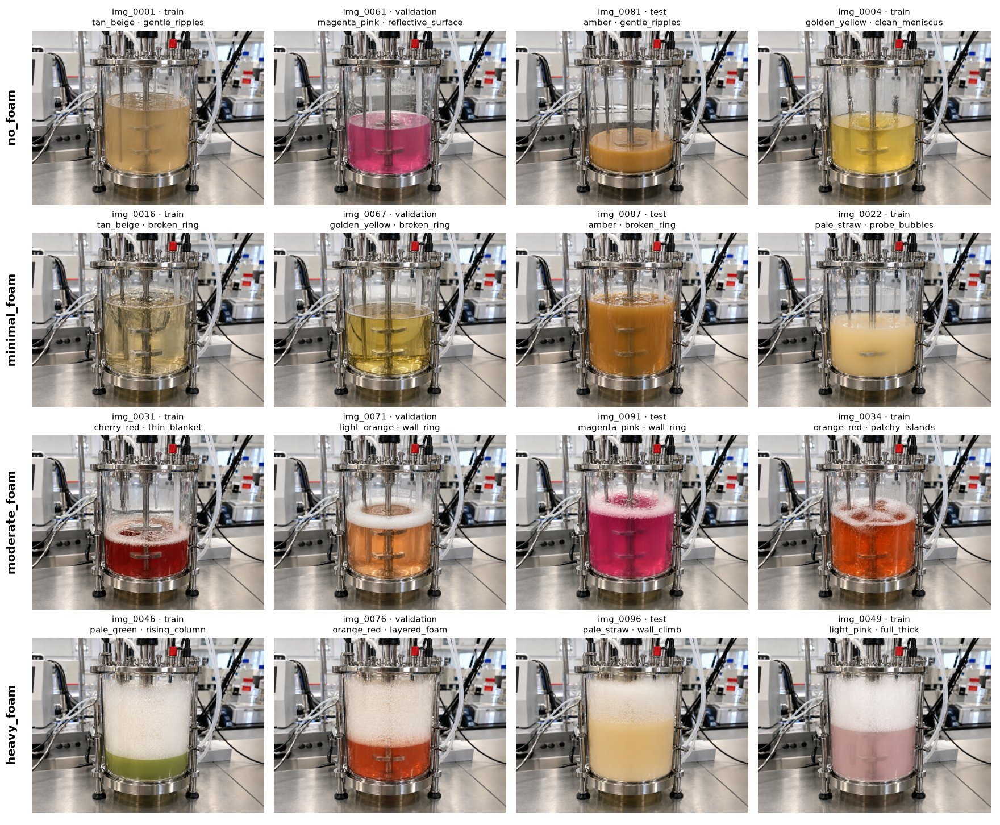
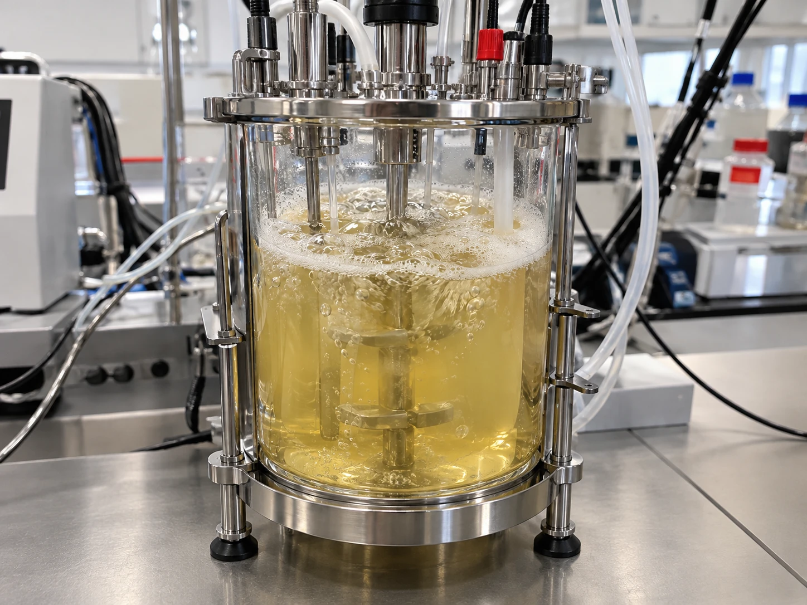

# AI-Powered Bioreactor Foam Monitoring

Can a computer-vision model recognize foam levels in a laboratory bioreactor from an outside camera image,
and tell an operator when intervention may be needed?



*Synthetic images of the same 500 mL bioreactor. Each row is one foam class; each column is a different
operating condition (medium colour, fill level, turbidity, agitation). Captions show the image ID, its
dataset split, the medium colour and the foam pattern.*

---

## Project idea

Foam can build up while a bioreactor is running, and an operator or scientist may need to step in. This
project tests whether a computer-vision model can classify the foam level from images of a bioreactor and
help users recognize when intervention may be needed.

The first version uses **synthetic images** generated with an OpenAI image model. They simulate a camera
placed outside a transparent bioreactor. A classification neural network will analyze each image, and a
simple dashboard will display the result and let the user alert an operator.

## Roadmap

| Phase | Goal | Status |
|---|---|---|
| **1. Synthetic dataset** | Generate 100 labelled images of one bioreactor from a reference photo, with a leakage-safe train/validation/test split | ✅ Done |
| **2. Classification model** | Train a neural network to classify the four foam levels | ⏳ Next |
| **3. Evaluation** | Measure performance on unseen operating conditions and improve generalization | Planned |
| **4. Inference & dashboard** | Process bioreactor images and show the foam level, with an option to alert an operator | Planned |

---

## Phase 1 — Synthetic dataset

### Results

| | |
|---|---|
| Images | **100 / 100** generated, all on the first attempt |
| Model | `gpt-image-2` through the image **edit** endpoint, with the reference photo attached to every request |
| Resolution | 1536 × 1152 PNG, matching the reference photo's 4:3 aspect ratio |
| Quality setting | `low` |
| Generation time | about 13 s per image, run one request at a time |
| Scenarios | 60 distinct operating conditions |
| Validation | All structural checks pass: counts, splits, no scenario leakage, no missing or corrupted files, no exact duplicates |

| Foam class | Train | Validation | Test | Total |
|---|---:|---:|---:|---:|
| `no_foam` | 15 | 5 | 5 | 25 |
| `minimal_foam` | 15 | 5 | 5 | 25 |
| `moderate_foam` | 15 | 5 | 5 | 25 |
| `heavy_foam` | 15 | 5 | 5 | 25 |
| **Total** | **60** | **20** | **20** | **100** |

### Reference image

Every image is generated from this one photo of a 500 mL benchtop bioreactor
([`reference/prototype.webp`](reference/prototype.webp)):



---

## Design decisions

### 1. Synthetic data generated from a single reference photo

**Decision:** Generate the images with an image *edit* request that receives the reference photo as an input
image, rather than with text-to-image generation.

**Why:** The goal is 100 operating conditions of **one physical bioreactor**, not 100 different
bioreactors. Attaching the photo makes the model keep the vessel geometry, hardware, camera angle and
background. A text description alone would produce a different vessel every time.

**Trade-off:** The images are synthetic, so a model trained on them will meet a *domain gap* on real camera
footage. That is acceptable for a proof of concept, and real images can be added later.

### 2. Model: `gpt-image-2`

**Decision:** Use `gpt-image-2` through `client.images.edit`.

**Why:** It accepts reference images and arbitrary output sizes. The notebook therefore requests 1536×1152
to match the photo's 4:3 aspect ratio, so the framing is not cropped or distorted. DALL·E 3 was ruled out
because it cannot take a reference image. `gpt-image-1.5` and `gpt-image-1` remain configurable alternatives;
for those models the notebook adds `input_fidelity="high"`.

**Quality:** The images were generated at `low` quality to keep this proof of concept fast and cheap. The
notebook supports `medium` and `high` if finer foam texture turns out to matter.

### 3. Four foam classes with deliberate gaps between them

**Decision:** Use four classes, each defined by a surface-coverage range. The ranges leave gaps between
neighbouring classes:

| Class | Definition used in the prompt |
|---|---|
| `no_foam` | No foam layer, bubble clusters or froth; clean meniscus |
| `minimal_foam` | A few isolated bubbles or traces of foam, **clearly under ~10 %** of the surface |
| `moderate_foam` | A noticeable foam layer covering **~30–70 %** of the surface; open liquid still visible |
| `heavy_foam` | **The entire surface** covered by thick foam that rises into the headspace |

**Why:** Synthetic labels are only as reliable as the prompt that produced them. Leaving gaps between
classes (for example, nothing between 10 % and 30 % coverage) keeps borderline images out of the dataset,
so each label matches what the image shows. The `minimal_foam` class captures early foam formation, which
is when an operator alert is most useful.

### 4. Scenario-based splitting instead of a random split

**Decision:** Assign train, validation and test splits to *operating scenarios* **before** generating any
images. Never split individual images at random.

**Why:** Images generated from the same reference and similar prompts can be nearly identical. If two
images of the same operating condition ended up in both train and test, the test score would measure
memorization rather than generalization to new conditions.

**How it works:**

- A **scenario** is one complete operating condition: fill level, medium colour, turbidity, agitation,
  lighting, foam class, foam pattern and bubble size.
- The **leakage unit** is the *liquid condition*: fill level × medium colour × turbidity. Each of the 60
  scenarios has its own liquid condition, so no condition appears in more than one split.
- **Train** uses 5 scenarios × 3 shots per class. The 3 shots of a scenario show natural variation within
  one condition.
- **Validation and test** use 5 scenarios × 1 shot per class. One image per condition gives the largest
  possible number of *independent* conditions to evaluate on.
- The plan is deterministic (`RANDOM_SEED = 42`) and saved to `metadata/generation_plan.csv` before the
  first API call.

### 5. Balanced coverage and no shortcut features

**Decision:** Within every split and class, spread fill levels, turbidities, lighting setups and foam
patterns evenly. Let agitation overlap across classes on purpose.

**Why:** Every split then covers the same *range* of conditions without sharing any specific condition, so
validation and test are neither easier nor harder by chance. If vigorous stirring appeared only with heavy
foam, a model could learn "turbulent surface means heavy foam" instead of looking at the foam itself. The
overlap prevents that shortcut.

### 6. Layered prompts

**Decision:** Build each prompt from separate blocks: the base scene description, instructions to preserve
the reference, the foam-class definition, the scenario's operating condition, the shot variation, and a
list of things to avoid.

**Why:** Each block can be changed independently, and the exact final prompt for every image is stored in
the metadata, so any image can be traced back to how it was made. The reference photo already contains
foam and rising bubbles, so the base prompt explicitly tells the model **not** to copy the liquid or foam
from the reference. Without that instruction, the `no_foam` images would inherit the reference's foam.

### 7. Plan first, spend later

**Decision:** The notebook starts in `dry_run` mode by default, which builds and validates the plan without
any API calls. A `test` mode generates one image per class. Once images exist, the plan is **locked**.

**Why:** Image generation costs money. The plan, counts and prompts can be fully checked for free, and a
cheap test run shows whether the reference is preserved before generating all 100 images. The lock stops
images generated under two different plans from being mixed, which would break the split guarantees.

### 8. Robust, resumable generation

**Decision:** Send requests one at a time with exponential backoff and jitter. Write each image atomically
and save the metadata after every image. Stop early on authentication, quota or permission errors, or when
an estimated budget limit is reached.

**Why:** A run of 100 images can be interrupted by rate limits, network problems or a laptop going to sleep.
Rerunning the notebook continues where it stopped, and valid images are never regenerated or overwritten.

### 9. One notebook for Phase 1

**Decision:** Keep all of Phase 1 in a single, well-documented notebook.

**Why:** Phase 1 is one linear workflow, and a notebook shows the plan, prompts, images and validation side
by side. At the start of Phase 2, the shared parts (paths, class and split constants, metadata loading,
validation) will move into a small Python module so that every phase uses the same definitions.

---

## Validation and known limitations

**Structural checks: all pass.** The validation checks confirm 100 images, 25 per class, the 60/20/20 split
with 15/5/5 per class, unique IDs, no scenario or liquid condition in more than one split, no images moved
between splits, and no missing, corrupted or exactly duplicated files.

**The perceptual-similarity check is not informative for this dataset.** The notebook compares a 256-bit
difference hash (dHash) for every image pair and flags cross-split pairs whose hashes are close. Every image
shares the same vessel, camera and background, so the whole-image hashes are dominated by that shared scene.
At the default threshold, **1,815 cross-split pairs were flagged**. The closest cross-split pair (distance
0.008) was closer than the median pair of shots from the *same* scenario (0.045). The hash therefore cannot
tell operating conditions apart. The protection against leakage comes from the scenario-based plan; the
similarity check only reports. A better check would compare embeddings of the vessel region only (for
example CLIP or DINO features of a crop).

**Other limitations:**

- **Domain gap:** the images are synthetic. Real camera images will differ in noise, glare and colour.
- **One vessel, one camera angle, one background:** a model may not generalize to other setups.
- **`minimal_foam` is subtle:** at thumbnail size, some `minimal_foam` images look close to `no_foam`.
  The labels come from the prompts and were checked by manual review, but this is the class boundary most
  likely to need relabelling or a clearer definition.
- **Small dataset:** 100 images is enough for a proof of concept, not for a reliable model.

---

## Repository structure

```text
bioreactor-foam-detection/
├── notebooks/
│   └── generate_synthetic_dataset.ipynb   Phase 1 notebook (with outputs from the generation run)
├── reference/
│   └── prototype.webp                     reference bioreactor photo
├── data/
│   ├── train/{no_foam,minimal_foam,moderate_foam,heavy_foam}/        60 images
│   ├── validation/{no_foam,minimal_foam,moderate_foam,heavy_foam}/   20 images
│   └── test/{no_foam,minimal_foam,moderate_foam,heavy_foam}/         20 images
├── metadata/
│   ├── generation_plan.csv                planned images, scenarios, splits and exact prompts
│   ├── metadata.csv                       one row per image: parameters, prompt, model, timing, tokens
│   ├── validation_report.csv              PASS / WARN / FAIL / INFO checks
│   └── generation.log                     generation run log
├── docs/images/                           README figures
├── requirements.txt
├── LICENSE
└── README.md
```

Each image is named `<image_id>_<scenario_id>.png`, for example `img_0042_S14.png`, and the folder it is in
gives its split and class.

### Metadata

`metadata/metadata.csv` contains `image_id`, `filename`, `file_path`, `foam_class`, `scenario_id`,
`dataset_split`, `liquid_level`, `liquid_color`, `turbidity`, `foam_pattern`, `generation_prompt`, `model`,
`generated_at` and `status`. It also records `liquid_condition_id`, `agitation`, `lighting`, `bubble_size`,
`shot_index`, the requested size and quality, the image dimensions, attempts, duration, token usage and any
error message.

---

## Getting started

### Use the dataset

Clone the repository. The images in `data/` are ready to use, and `metadata/metadata.csv` describes each
one. You do not need an OpenAI key.

### Regenerate or extend the dataset (macOS)

Requires Python 3.11 or later and an OpenAI API key with access to GPT Image models. OpenAI may require
organization verification before you can use them.

```bash
python3 -m venv .venv
```

```bash
source .venv/bin/activate
```

```bash
pip install -r requirements.txt
```

```bash
export OPENAI_API_KEY="your-key-here"
```

```bash
jupyter lab notebooks/generate_synthetic_dataset.ipynb
```

If you don't set `OPENAI_API_KEY`, the notebook asks for the key in a hidden input field. The key is never
printed or saved.

Set `RUN_MODE` in Section 2, then run **Kernel → Restart Kernel and Run All Cells**:

| `RUN_MODE` | What happens | API cost |
|---|---|---|
| `"dry_run"` *(default)* | Builds and validates the scenario plan only | none |
| `"test"` | Generates one image per foam class into the dataset folders | a few images |
| `"full"` | Generates every image that is still missing | up to 100 images |

- **Resuming:** if a run is interrupted, rerun the notebook. It skips valid images and generates only the
  missing or failed ones.
- **Cost:** set `ESTIMATED_COST_PER_IMAGE_USD` from the [OpenAI pricing page](https://openai.com/api/pricing/).
  Costs shown in the notebook are estimates; actual charges are on the
  [OpenAI usage dashboard](https://platform.openai.com/usage).
- **Starting over:** the plan is locked once images exist. To regenerate with a different seed, prompts or
  design, set `ARCHIVE_EXISTING_RUN = True` and run the notebook once. This moves `data/` and `metadata/`
  into `archive/run_<timestamp>/` without deleting anything. Then set it back to `False`.

---

## License

This project is released under the [MIT License](LICENSE).
